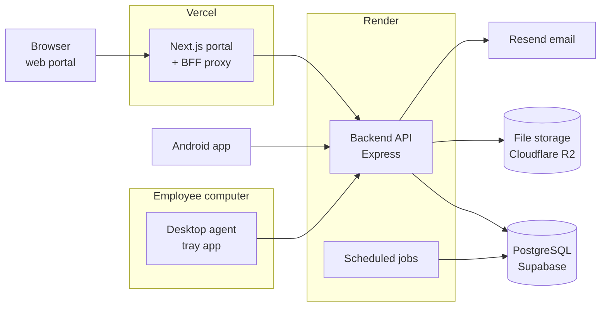

# WorkInvigilator: Product Overview

WorkInvigilator (earlier called WorkBuddy / KD Tracker) is the attendance, work-monitoring, leave and payroll system for a
remote team. Employees punch in and out, an agent on their computer records screenshots and activity while they work, and HR
and team leaders see who is working, who needs a look, and what everyone should be paid.

> Everything here is **disclosed monitoring**: employees accept a notice before the first shift, a visible tray app shows when
> capture is on, every look at captured media by HR or a leader is written to an audit log, and files are deleted after a set
> number of days (31 by default).

## 1. The pieces

| Piece | What it is | Who uses it | Folder |
|---|---|---|---|
| **Web portal** | Next.js site (Vercel). Every role signs in here. | Everyone | `web/` |
| **Backend API** | Node + Express + Knex. The single source of truth. Render in production. | The portal and the agents | `backend/` |
| **Desktop agent** | Electron tray app for Windows, macOS and Linux. Screenshots, activity, mic check, punch buttons, offline queue. | Employees | `desktop-agent/` |
| **Android app** | Kotlin app: punch, capture while punched in. | Employees (phone) | `android-agent/` |
| **Database** | SQLite in development and tests, PostgreSQL (Supabase) in production. | Backend only | `backend/src/db/` |
| **File storage** | Screenshots, audio, leave proofs, company logo. Local folder, or S3-compatible (Cloudflare R2) in production. | Backend only | `backend/src/storage/` |
| **Email** | Resend: payslips, new-device alerts. Optional. | Backend only | `backend/src/services/mailer.js` |

## 2. Roles

| Role | Who | Sees and does |
|---|---|---|
| **Employee** (`user`) | Everyone on the team | Punch, breaks, own history, leave, time corrections, payslips, calendar, security |
| **Leader** (`leader`) | Team lead of one or more departments | Everything an employee does, plus their own team: live board, member detail, leave approvals |
| **Admin / HR** (`admin`) | HR and company admins | Everything about people and attendance: employees, departments, timesheet, screenshots, reports, productivity, leave, time corrections, audit log, settings |
| **Account admin** (a flag on an admin) | The admins who run pay | Everything an admin does, plus payroll, payslips, the payment list, employees' bank details, and the pay settings |

An account admin is not a fifth role: it is a switch on an admin account. HR can give it to another admin but not to themselves, and
every account admin is told when it changes. Details: [Security and privacy](08-SECURITY_AND_PRIVACY.md).

## 3. What the system does, by area

| Area | Capabilities |
|---|---|
| **Attendance** | Punch in/out from portal, agent or phone; breaks with a daily allowance; auto-break on sign-out; auto-close of forgotten shifts; no punching on Sundays and company holidays; offline punches replayed with their real time |
| **Monitoring** | Random screenshots (every 5 to 10 minutes), optional audio samples, mic-muted detection, keyboard and mouse counts, active app and website, Zoom camera-off rule (Windows), multi-display capture |
| **Live views** | Live board, Timesheet (live hours per person per day), Screenshots (everyone, with a full-screen viewer), Mic log, dashboard charts and the "Who needs attention" score |
| **Leave** | Five leave types, half days, proof upload, leader or HR approval, nobody approves their own, yearly allowance and balance |
| **Time corrections** | Employees ask to fix a forgotten punch-in or punch-out; HR approves |
| **Payroll** | Pay rates, bonuses, company holidays, monthly generation, finalize (freeze) and reopen, payslips (view, PDF, email), bank details (encrypted), month-end payment list CSV |
| **Calendar** | Month view of holidays, leave and birthdays; birthday reminders to HR and the team leader |
| **Security** | Password rules, two-step sign-in (authenticator app), session list with remote sign-out, sign-in history, new-device alerts, audit log |
| **Administration** | Employees, departments, leaders, projects, app and website categories, settings, company logo |

## 4. Key rules to know

- **Company time zone:** all dates, days and punch times use New York time (`APP_TIMEZONE`), whatever country a computer is in.
- **Money** is stored in integer cents and never as floating point.
- **Capture only happens** when the agent is signed in, the person is punched in, not on a break, and has accepted the notice. Audio needs its own consent, checked on the server.
- **Break time and paid time:** worked time = time between punch-in and punch-out minus breaks. Only Company Vacation is paid leave by default; the rest is no-pay leave, with or without proof.
- **A finalized payroll month is frozen.** Time corrections, holidays and bonuses for that month are refused until HR reopens it.
- **Nothing is deleted from the audit log.** There is no route that edits or removes an entry.

## 5. Glossary

| Term | Meaning |
|---|---|
| **Shift** | One punch-in to punch-out. A person can have several in a day; the Timesheet merges them per day. |
| **Flagged / Needs a look** | A day with an over-break, an auto-closed shift, or a time that needed HR confirmation. |
| **Auto-closed** | The system ended a shift nobody punched out of, after `SHIFT_AUTO_CLOSE_HOURS` (16 by default). |
| **Over break** | Break time over the daily allowance (60 minutes by default). |
| **Idle** | A stretch with no keyboard or mouse activity longer than the idle threshold (10 minutes by default). |
| **Outbox** | The agent's local queue of punches and captures waiting to upload. |
| **BFF** | The portal's server-side proxy (`/bff/...`). It holds the tokens in httpOnly cookies so the browser never sees them. |
| **Session** | One sign-in on one device. Ending it signs that device out at once. |
| **Finalize** | Freeze a payroll month: payslips are stored as they are, employees can see them. |
| **Recovery code** | A one-time code that signs you in when you lost your authenticator phone. |
