# Workflows

How each thing actually happens, step by step, from the person's click to the database. Diagrams are Mermaid: GitHub and
VS Code render them.

Contents
1. [Onboarding a new employee](#1-onboarding-a-new-employee)
2. [Signing in (password, two-step, new device)](#2-signing-in)
3. [Connecting the desktop agent](#3-connecting-the-desktop-agent)
4. [A working day: punch, break, punch out](#4-a-working-day)
5. [Capture: screenshots, audio, activity, mic](#5-capture)
6. [Offline and flaky connections](#6-offline-and-flaky-connections)
7. [Zoom camera-off auto break (Windows)](#7-zoom-camera-off-auto-break)
8. [Forgotten or wrong punches: time corrections](#8-time-corrections)
9. [Leave: request, balance, decision](#9-leave)
10. [Month-end payroll](#10-month-end-payroll)
11. [Paying people: bank details and the payment list](#11-paying-people)
12. [Dashboard, timesheet, screenshots and "Who needs attention"](#12-reviewing-the-team)
13. [Security: sessions, history, two-step, audit](#13-account-security)
14. [Birthdays and notifications](#14-birthdays-and-notifications)
15. [Scheduled jobs](#15-scheduled-jobs)
16. [Leaving the company: deactivation](#16-deactivating-someone)

---

## 1. Onboarding a new employee

**Who:** HR (admin). **Where:** Employees, then Add employee.

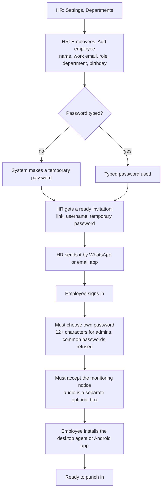

Steps and rules
1. HR creates departments first (Settings, Departments), then the employee (name, work email, role, department, employee code, optional birthday).
2. The temporary password is shown **once** with the invitation. Lost it? Open the employee and click **Send invitation**: it makes a new password, signs the person out everywhere and gives a new message.
3. First sign-in forces a new password (`mustChangePassword`). Until then the server refuses everything except `me`, `change-password` and sign out. Changing it signs out every session, so the person signs in again with the new one.
4. Before any punch-in the person must accept the monitoring notice (`consentMonitoring`). Audio consent is separate and can be declined or withdrawn later. Monitoring consent can only be withdrawn through HR.
5. Leaders are made on the employee's page (**Assign as leader** for a department). The person is then told by notification, and their sessions are ended so the role takes effect.
6. If an account admin has set a bank account for the employee (optional, see [section 11](#11-paying-people)) the payment list is complete.

---

## 2. Signing in

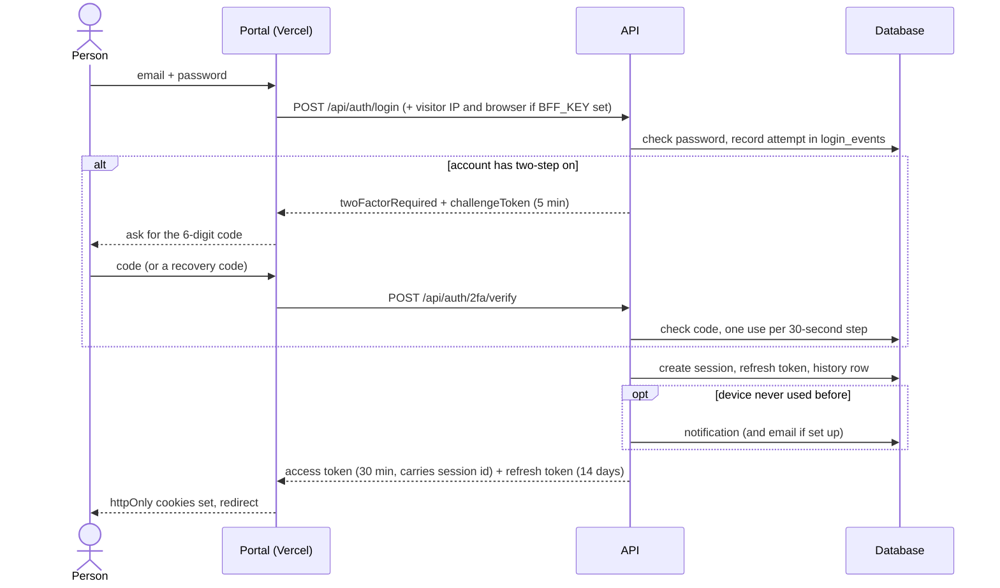

Rules
- Wrong password is logged as `bad_password`; unknown email gives the same message and timing, so emails cannot be probed.
- Rate limit: 10 sign-in attempts per 15 minutes per IP and email.
- **Two-step:** after the password a code from an authenticator app is asked for. Five wrong codes in 15 minutes hold the account for the rest of the window, even for a right code. A code works once. A recovery code works once.
- **Required for admins** when HR switches that setting on: an admin without it set up can only open the Security page until they do. HR must have it themselves before switching the rule on.
- **Desktop agent and Android** cannot answer a code: for an account with two-step they refuse a direct password login and ask the person to sign in on the portal and connect the app from there.
- **Tokens:** the access token (30 minutes) is checked against the session on every request. The portal's middleware refreshes it a minute before it expires, and the refresh token rotates (a reuse long after rotation ends every session as a theft response).
- **Ended sessions:** signing out from another device, an HR "sign out everywhere", a deactivation or a password change ends the session; its access token stops working on the next request, not at expiry.
- **New device:** a sign-in whose browser and system never signed in before (the person has signed in before) creates a notification, and an email when email is configured.

---

## 3. Connecting the desktop agent

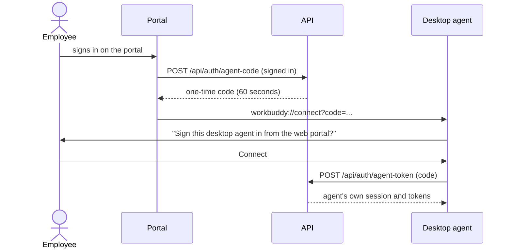

- The link scheme is still `workbuddy://` (kept so already-installed agents keep working).
- A link never swaps the account an agent already runs as: if someone is signed in, it is ignored.
- The agent appears as its own session under Security, and can be ended there.
- Agents sign in again on their own after a restart; they start with Windows/macOS/Linux login.

---

## 4. A working day

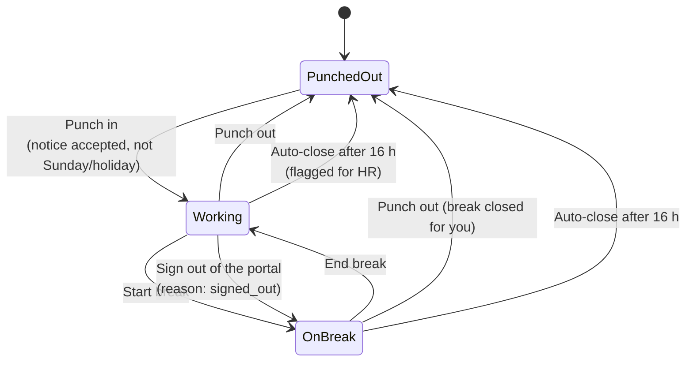

Rules
- **Punch in** needs the monitoring notice, no other open shift, and a working day. Sundays and company holidays refuse (`DAY_OFF`). Punching in on the portal or the agent is the same thing; the other shows it within about 20 seconds.
- **Break:** capture and the work clock pause. The allowance (60 minutes by default, set in Settings) is shown. Over it, the day is flagged and the agent reminds every 5 minutes.
- **Signing out while punched in** puts the shift on a break (reason `signed_out`). The person must click **End break** after signing in. Punch out (not just sign out) when finished.
- **Punch out:** closes a running break, adds project time, computes worked = gross minus breaks, adds idle seconds, flags over-break. A single shift can carry several flag reasons.
- **Auto-close:** a shift still open `SHIFT_AUTO_CLOSE_HOURS` after punch-in (16) is closed by a job at that mark, flagged "never punched out", for HR to confirm. The employee can then ask for a time correction.
- **Projects:** if HR created projects, the person picks "Working on"; project time ends with the shift.
- **Several shifts in a day** are allowed (power cut, restart); worked time is the sum, counted once.

---

## 5. Capture

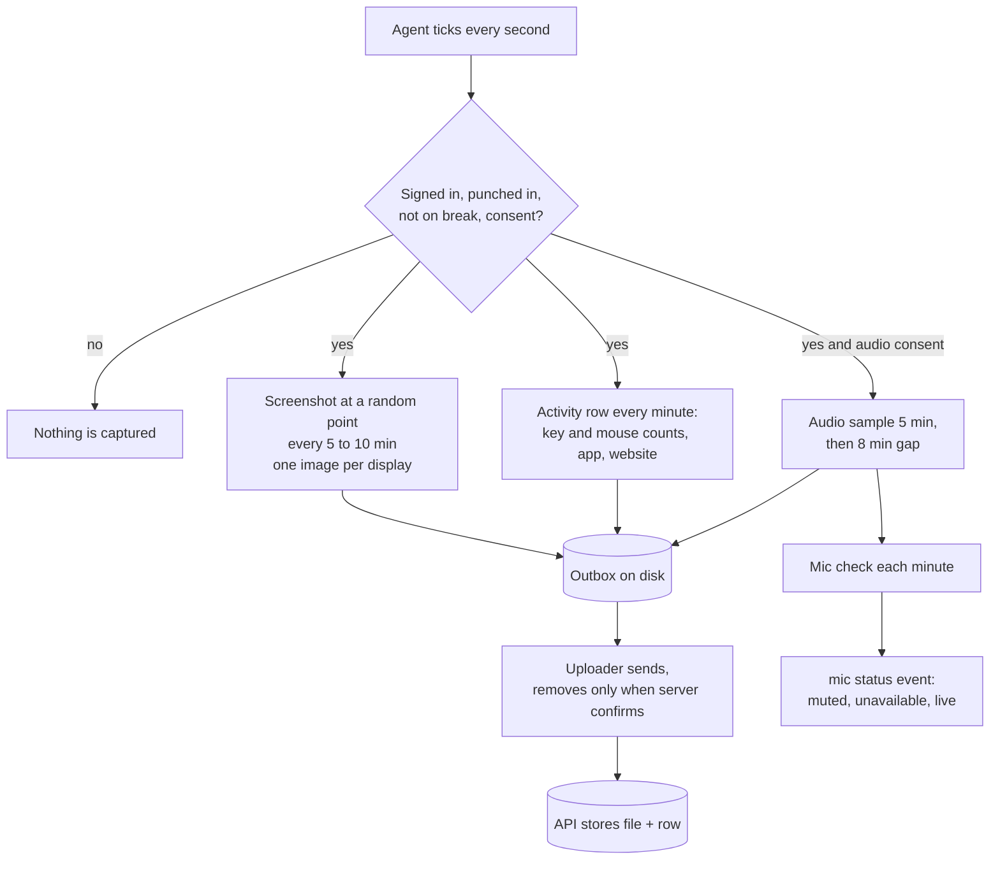

- **Screenshots:** random interval between the configured min and max. The server stores the file, a row, the capture group (several screens = one tile) and the date. Idle screens are still captured.
- **Content is never captured:** only counts of keystrokes and mouse actions and the name of the active app. No typed text.
- **Audio** is optional, needs audio consent (checked on every upload on the server), and stays within the sample length limit (a longer "sample" is refused as continuous recording).
- **Mic watch:** a quick check about once a minute. A muted or unavailable mic is reported with exact start and end times (the Mic log), and HR and the team leader get **one** "Mic not active" notification for that problem. The same problem carrying on later the same day is logged but not announced again; it alerts anew only after the mic was live in between or on a new day.
- **Blur:** HR can switch "blur screenshots" on for a person; the portal blurs them until a click.
- **Viewing:** pictures stay closed until clicked. Opening one is a request that is written to the audit log, and the full-screen viewer fetches only the picture on screen (no preloading).
- **Retention:** a nightly job deletes the files after `RETENTION_DAYS` (31); the database row stays, so reports still count the capture.

---

## 6. Offline and flaky connections

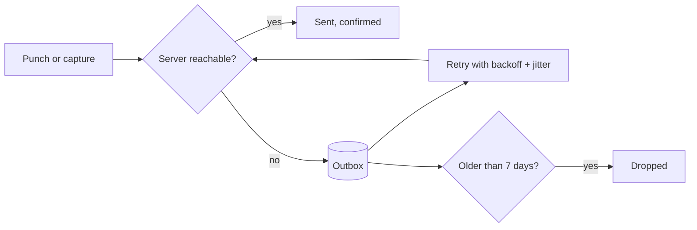

- **Punches** keep the time they happened. The server accepts a queued punch time up to `MAX_BACKDATE_HOURS` (4) back; older ones are recorded at server time and **flagged** for HR. A queued punch or break time more than `REVIEW_BACKDATE_MINUTES` (10) late but inside the limit is kept and the shift is flagged "to check" too (this is how a shortened break shows up). The capture watch also flags an agent that is connected but delivers no activity samples for `AGENT_NO_DATA_MINUTES` (10), and near-identical busy keyboard/mouse readings for `PATTERN_MINUTES` (30) (a jiggler or macro). All flags only: hours and pay do not change. Times in the future (beyond a small clock skew) are refused.
- **Captures** can be uploaded up to `MAX_CAPTURE_AGE_DAYS` (7) late. Uploads are idempotent (a capture id), so a retry never doubles a picture.
- Nothing is removed from the outbox because of a bad connection; only a server answer that retrying cannot change (already punched in, outside the window) removes an item.
- The tray icon turns red and shows the backlog while there is one. The popup shows how many items wait and the oldest age.
- The **web portal** has no offline queue: a punch made without internet fails with an error, and is retried by the person.
- No punch-out ever: the shift is auto-closed after 16 hours and flagged (see section 4).

---

## 7. Zoom camera-off auto break

Windows desktop agent only, and only when HR sets **Settings, Shift and breaks, Camera off in Zoom starts a break after (minutes)** above 0 (default 0 = off).

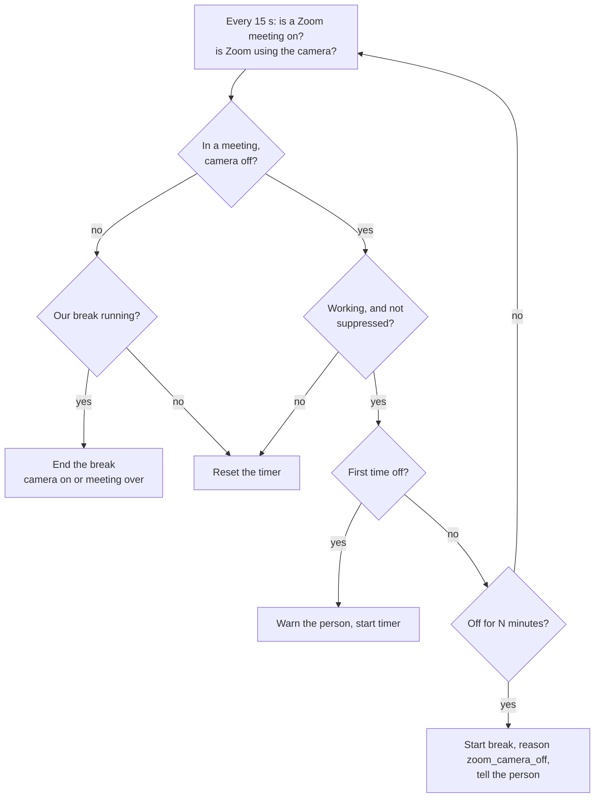

- It reads two facts Windows already keeps: a window titled "Zoom Meeting" or "Zoom Webinar" (or the meeting-only helper process), and the webcam "in use" record. It never sees video, audio or the meeting.
- The person is **warned** when the camera first goes off and **told** when the break starts.
- A break the person started is never touched. If they end the automatic break themselves while the camera is still off, it does not start again in that meeting.
- If Windows cannot answer (blocked, not Windows) the agent does nothing.
- Break time is not paid time, so HR turns this on knowingly. The My shift panel explains why a break began.

---

## 8. Time corrections

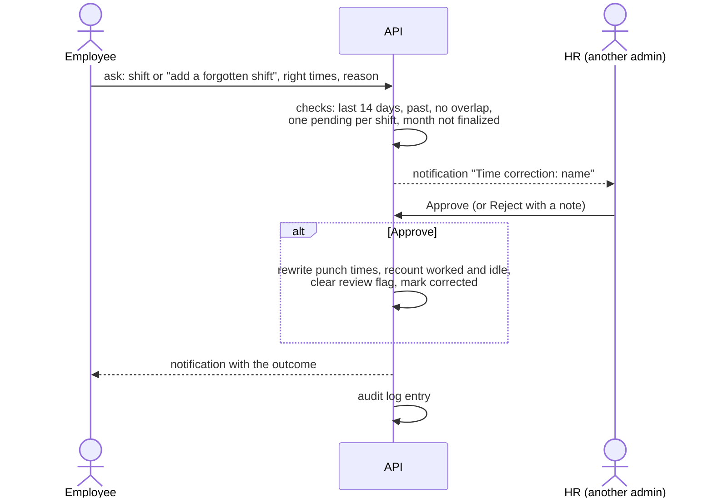

- Where: employee menu **Time corrections**, or **Fix times** beside a shift in My history. HR: **Time corrections** in the menu.
- The original times stay on the request. Times are entered as New York clock times.
- **Refused when:** older than 14 days, in the future, over 20 hours, overlapping another shift of the person, a request already waiting for that shift, or the payroll month is finalized (reopen it first).
- **Nobody decides their own request:** an admin's request is decided by another admin. A rejection needs a reason.
- Approving re-checks for overlap at that moment.

---

## 9. Leave

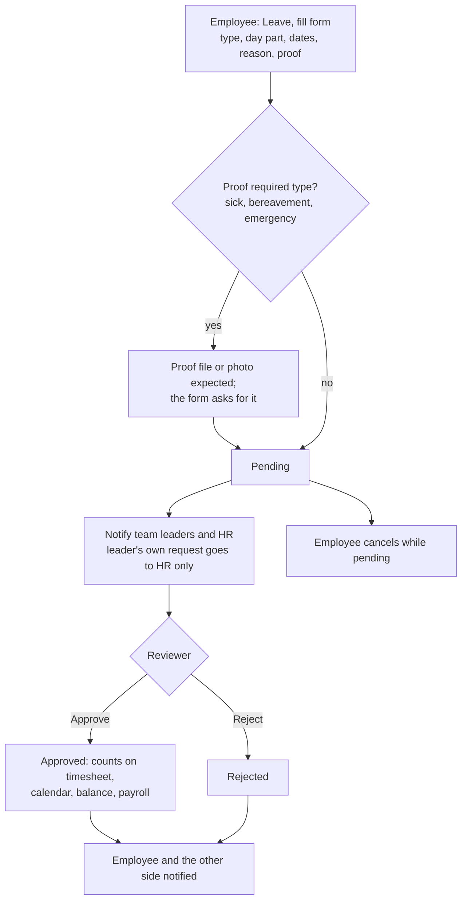

- **Types:** Sick, Bereavement, Personal, Emergency, Company Vacation. Only Company Vacation is paid unless HR changes the paid types in payroll settings. Proof does not make leave paid; it only helps the reviewer.
- **Half days** (AM or PM) are a single date. A proof file attached by mistake can be removed with **Remove file** before sending (JPEG, PNG, WEBP or PDF, up to 5 MB). Proof is only so the reviewer can check the reason.
- **Who decides:** a leader decides their department's members; HR decides everyone. **No one decides their own leave:** an admin's goes to another admin, a leader's goes to HR.
- **Balance:** HR sets a yearly allowance per type in Settings (blank = no limit, half days allowed). Days are working days: not Sundays, company holidays or non-working days, half day = 0.5, the calendar year. Employees see taken, waiting and left; the reviewer sees a request's working days and the days left if approved, in red when over. Over the allowance is **shown, not blocked**.
- **Effects:** approved leave marks the person "On leave" on the live board and timesheet, shows on the calendar, and feeds payroll as paid or no-pay.

---

## 10. Month-end payroll

Account admins only.

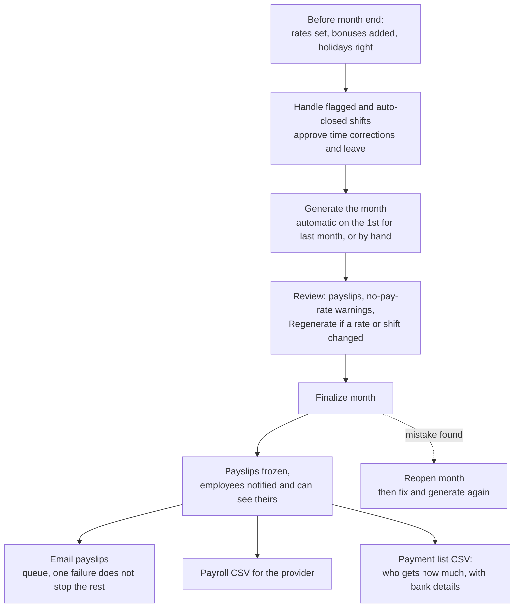

1. **Rates:** each employee needs a pay rate valid for the dates worked. A day with no rate is paid nothing and the page warns in orange. Rates can be bulk uploaded.
2. **Bonuses** and **company holidays** are added or uploaded for the month. (Holidays are also editable by an ordinary HR admin; they feed the calendar and the punch ban.)
3. **Generate** (`/api/payroll/generate`) works from closed shifts: full day and half day thresholds, paid leave types, holidays, optional deduction of idle time, the work days. It is safe to run again: it updates, never duplicates.
4. **Finalize** checks payslips are current (if a rate or shift changed after generating it asks you to regenerate), warns about shifts still open and days with no rate, then **freezes** each payslip as a snapshot and notifies employees. Holidays, bonuses and time corrections in that month are then refused.
5. **Reopen** removes the freeze so changes are possible; finalize again afterwards.
6. **Payslips:** on screen, as PDF, printable, and emailed. Email uses the company name and the HR-chosen template (colours, font, which lines show). A queue worker sends them one per recipient and shows failures per person.
7. The month's work is automatic on the 1st at 03:00 (`CRON_PAYROLL`) for the previous month; HR still reviews and finalizes.

---

## 11. Paying people

Account admins only. Nothing pays anyone by itself: WorkInvigilator makes the list and the bank file; money is moved in the bank.

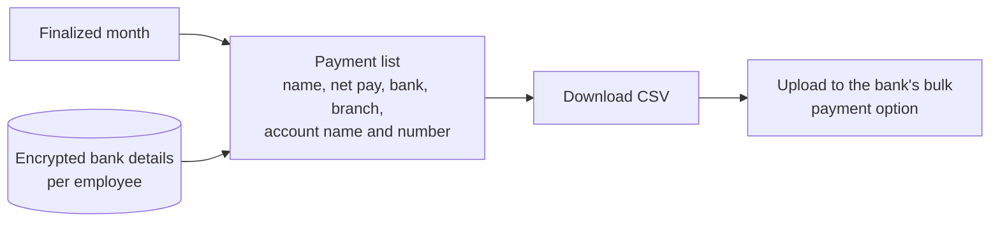

- **Bank details** (bank, branch, account number, account name) are saved on the employee's page by an account admin. They are encrypted (AES-256-GCM, key `BANK_DATA_KEY`, bound to the employee id) and only an account admin can see them. The page shows the account number masked; revealing it is a separate action.
- **Every look is audited:** viewed, saved and removed, and whether the account number was shown. Values are never written to the audit log.
- The payment list exists only for a **finalized** month, built from the frozen payslips. People with no bank details are counted so HR can fill the gaps.
- If `BANK_DATA_KEY` is not set the feature answers "switched off" (503) instead of storing anything unencrypted. Back the key up: losing it makes saved details unreadable.
- Sri Lanka note: the chosen route is the bank bulk file (works with any bank, lowest risk). Online-payment integration was considered and not built.

---

## 12. Reviewing the team

| Page | For | Shows |
|---|---|---|
| **Dashboard** | HR | Today's tiles (working, break, finished, not started, on leave, needs a look), "Team today" circles, who needs attention now (pending leave, flags, birthdays, holiday), **Last 14 days** bars (hours, people, break time, flags), **Who needs attention** by department, attendance by department |
| **Live board** | HR, leaders | Who is working, on break or out right now, live worked time, idle and flags |
| **Timesheet** | HR | Per person per day: in, out, worked (live for a running shift), break, idle, flags, screenshot count, mic-muted count and time; filters for date range (31 days), employee (searchable), department; people who have not started or are on leave for a single day |
| **Screenshots** | HR | Everyone's screenshots grouped by person with date, employee and department filters (7 days at a time); closed until clicked; full-screen viewer |
| **Mic log** | HR, leaders | When a mic was muted or unavailable, for how long, and when it came back |
| **Productivity** | HR | Score per person from active time and app use; app and website categories per department or company-wide |
| **Reports** | HR | Attendance report with CSV export |

**Who needs attention** (dashboard)
- One score per person over the last 14 days from five parts: productivity 35%, punch-in time 20%, punch-out time 15%, breaks 15%, microphone 15%.
- Punch-in and punch-out need the workday start and end set in Settings (New York time, 10 minutes' grace); until set, those parts are left out. A part that cannot be measured (no audio consent, no activity data) is left out and the rest are re-weighted, so nobody is marked down for something never measured.
- Departments are ordered with the weakest first; click a person for the five parts and the reason for each ("Late on 5 of 6 days").
- It is a prompt to talk to someone, not a verdict: meetings, calls and approved leave can all look poor.

---

## 13. Account security

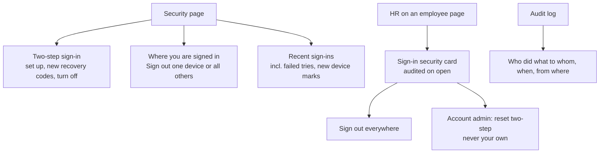

- **Set up two-step:** Security, Set up. Scan the QR code (or type the key) in Google Authenticator, Microsoft Authenticator or Authy, enter the 6-digit code to turn it on, then save the 10 recovery codes (shown once). Turning off or making new codes needs the password and a current code. Admins cannot turn it off while HR requires it.
- **Lost phone:** use a recovery code at sign-in. No codes left either: an account admin resets it (also ends the person's sessions); the person sets it up again.
- **Sessions:** the list shows device, app, address, when signed in, last active. "Sign out" ends one device immediately. Changing the password ends everything.
- **Audit log (HR):** viewed screenshots and audio, bank details, settings changes, leave and time-correction decisions, payroll finalize and reopen, account-admin grants, security views and resets. Filter by dates, action and employee. Entries cannot be edited or deleted.

---

## 14. Birthdays and notifications

- HR sets a birthday on the employee (also when adding). Only active employees appear. The year of birth is never shown.
- The birthday job (hourly in working hours, `CRON_BIRTHDAYS`) notifies HR and the person's team leader **the day before and on the day**. The birthday person is not told. A leader's or HR's own birthday goes to HR only. 29 February birthdays use 28 February in other years.
- Birthdays show as gold dots on the Calendar with a list below.
- **Notifications** (bell, red number): leave requests and decisions, time-correction requests and decisions, mic not active, birthdays, new-device sign-ins, account-admin changes, break reminders. Open Notifications to read and mark read.

---

## 15. Scheduled jobs

Run inside the API process when `ENABLE_SCHEDULER` is not false. Behind more than one API instance, turn it off and run them from system cron with `npm run job:*`.

| Job | Default schedule | Does |
|---|---|---|
| `purge` (`CRON_PURGE`) | 02:15 daily | Deletes screenshot and audio files past retention (rows are kept) |
| `close-shifts` (`CRON_CLOSE_SHIFTS`) | minute 10 every hour | Closes shifts open longer than the auto-close hours, flags them |
| `birthdays` (`CRON_BIRTHDAYS`) | minute 5 of hours 8 to 20 | Birthday reminders to HR and leaders |
| `payroll` (`CRON_PAYROLL`) | 03:00 on the 1st | Generates the previous month |
| payslip mail worker | every minute | Sends queued payslip emails |

Each run of the first four is recorded (job runs table) with what it affected, and one failing job cannot stop the API.

---

## 16. Deactivating someone

1. HR opens the employee, **Deactivate**. The account is locked and **every session is ended**; the agent is told (`ACCOUNT_DEACTIVATED`) and stops pretending to be signed in.
2. Their history, payslips and audit trail stay. Reactivating restores access.
3. They leave the active lists and the birthday calendar. An open shift (if any) is closed by the auto-close job; the real end can then be set with a time correction.
4. Ask them to uninstall the agent from any personal computer it was put on.
