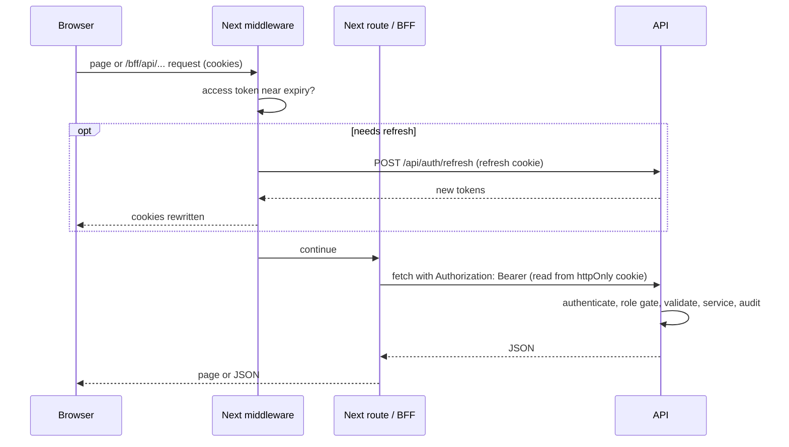
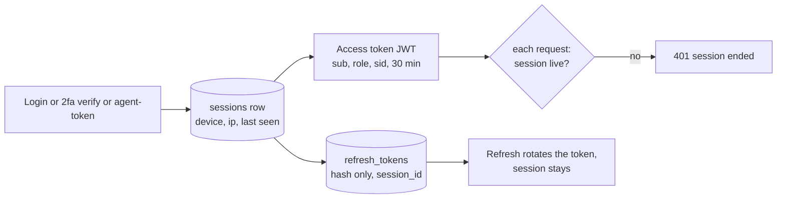

# Architecture

## 1. Layout

```
kd-tracker/
├── backend/            Express API, Knex migrations, jobs, tests (vitest + supertest)
│   └── src/
│       ├── app.js          builds the Express app (CORS, limits, routes)
│       ├── server.js       starts it, runs the scheduler
│       ├── config/         every setting, read once from the environment
│       ├── db/             Knex setup, 46 migrations, seeds, CLI
│       ├── middleware/     auth, rbac (role gates), validate (zod), rateLimit, errorHandler
│       ├── modules/        one folder per area (routes + service)
│       ├── services/       shared: settings, audit, notifications, mailer, birthdays, holiday calendar, bank details
│       ├── storage/        local and S3/R2 drivers
│       ├── jobs/           scheduler and job bodies
│       └── utils/          time, ids, errors, http helpers, totp, secretBox, device, passwordPolicy
├── web/                Next.js 15 (app router) portal
│   ├── app/                pages by role: /admin, /leader, /me, /calendar, /security, /bff, ...
│   ├── components/         AppShell (sidebar), tables, filters, charts, viewers
│   ├── lib/                api.js (server calls), client.js (browser calls), session.js, format.js
│   └── middleware.js       token refresh, redirect to /login
├── desktop-agent/      Electron: core (testable logic), main (OS access), renderer (tray popup)
├── android-agent/      Kotlin app
├── docs/               this documentation, ADRs, sprint history
└── scripts/            publish-update.js (uploads installers to R2)
```

Backend modules: `admin`, `attendance`, `auth`, `branding`, `calendar`, `capture`, `corrections`, `leader`, `leave`, `notifications`, `payroll`, `productivity`, `projects`, `public`, `super`.

## 2. Request path



- The browser **never holds a token**. Tokens live in httpOnly cookies (`kd_at`, `kd_rt`, `kd_exp`), SameSite Lax, Secure in production. Server components call the API directly (`web/lib/api.js`); browser code calls `/bff/...` which attaches the token (`web/lib/client.js`). ADR-0003.
- The BFF forwards only `/api/*`, refuses cross-origin writes (Origin check), and forwards `Range` so audio seeks work.
- Each API request re-reads the employee row, so deactivation, role and consent changes apply at once, not at token expiry.
- Special redirects: a 401 or `ACCOUNT_DEACTIVATED` goes to sign-in, `PASSWORD_CHANGE_REQUIRED` to change password, `TWO_FACTOR_SETUP_REQUIRED` to Security.

## 3. Backend conventions

- **Module = routes + service.** Routes validate with zod and call a service; services hold the rules and talk to the database.
- **Errors:** `ApiError(status, code, message, details)` for expected failures (400 bad request, 401, 403, 404, 409 conflict, 413, 429, 501); anything else is a 500 with no internals leaked.
- **Role gates** (middleware/rbac): `requireAdmin`, `requireAdminOrLeader`, `requireAccountAdmin`, `requireSelfOrAdmin`, `requireSelfOrAdminOrLeader` (a leader only for members of departments they manage, with seniority rules for sub-leaders). Admin-only routers are gated once at the router, so a new route cannot forget it.
- **Settings** are in the database (`settings` row), cached 30 seconds, edited in the portal; the environment supplies first-run defaults. What can change without a redeploy: capture intervals, shift rules, retention, pay rules, leave allowances, two-step requirement, workday hours, company name and logo, payslip template.
- **Time:** instants are stored as epoch milliseconds (bigint); dates as `YYYY-MM-DD` in the company zone (`APP_TIMEZONE`, New York). Helpers in `utils/time.js`.
- **Money** is integer cents everywhere.
- **IDs** are UUIDs made in the application.
- **Concurrency:** check-then-write races are closed by constraints and compare-and-set updates (one open shift per person is a partial unique index; a two-step code step is claimed with a conditional update; a finalize or generate in parallel is guarded).
- **Audit:** `services/audit.record(req, {...})` writes `audit_logs`. A failed audit write is logged and never turns a read into a 500, because a swallowed read is a worse problem than a missing row.
- **Notifications:** `services/notifications.notify` never throws; a failed notification must not undo the thing it announced.
- **Uploads** arrive as base64 in JSON (screenshots, audio, leave proof, logo), size-checked before decoding, with their own rate limit.

## 4. Data and storage

- **Database:** Knex with a portable schema (ADR-0001). SQLite for development and tests (`DB_CLIENT=sqlite`), PostgreSQL in production (`DB_CLIENT=pg`, `DATABASE_URL`). Migrations are plain files in `backend/src/db/migrations`, applied in name order; run `node src/db/cli.js migrate`. The full table list is in [Data model](04-DATA_MODEL.md).
- **Files:** a storage interface with a local driver and an S3 driver (Cloudflare R2: set `STORAGE_DRIVER=s3`, `S3_*`) (ADR-0002). Keys look like `type/employee/date/id.ext`. Files are fetched through the API (never public URLs), and each fetch of a capture is audited.

## 5. Sessions and tokens



- Refresh tokens are stored as SHA-256 hashes. Rotation has a 2-minute grace window for a lost response (ADR-0004); a reuse long after rotation revokes all of the person's sessions.
- `sid` in the access token is checked against `sessions` on each request (after the deactivation check, so a deactivated account still gets `ACCOUNT_DEACTIVATED`). Tokens from before sessions existed carry no `sid`, are allowed until refreshed, and then become a session.
- The algorithm is pinned to HS256.
- The visitor's address and browser reach the API only through the portal's server: it sends `X-BFF-Key`, `X-Client-IP`, `X-Client-UA`, and the API believes them only if the key matches `BFF_KEY`.

## 6. The desktop agent

`desktop-agent/src`
- `core/agent.js`: the brain. No Electron in it, so it is unit tested with fakes. Drives punch actions, the screenshot and audio schedulers, the mic watch, the Zoom camera rule and break reminders.
- `core/outbox.js` + `uploader.js`: the on-disk queue (better-sqlite3) and the drain loop with backoff, jitter and idempotent uploads.
- `core/scheduler.js`: random-interval and sampling schedulers.
- `main/`: Electron side. `capture.js` (all displays), `audio.js` (recorder window and mic check), `activity.js` (key/mouse counts, active app), `zoomCamera.js` (Windows meeting and camera detection), `notifications.js`, `trayIcon.js`, `updater.js` (auto-update, only while punched out), `index.js`.
- It syncs config (`/api/config`) and status (`/api/attendance/status`) on a timer, so an HR setting reaches running agents without a reinstall.
- Packaging: `electron-builder.yml`; app id `com.kdmarketing.workbuddy` and the `workbuddy://` link scheme are kept on purpose after the rename.

## 7. Web portal structure

| Area | Path | Notes |
|---|---|---|
| Public | `/login` | Password and code step |
| Employee | `/me`, `/me/history`, `/me/leave`, `/me/corrections`, `/me/payslips`, `/me/calendar` | |
| Everyone | `/calendar`, `/notifications`, `/security`, `/help`, `/download` | Own layouts so the sidebar is present |
| Leader | `/leader`, `/leader/members`, `/leader/members/[id]`, `/leader/leave` | Scoped to their departments by the server |
| Admin | `/admin` (live board), `/admin/dashboard`, `/admin/timesheet`, `/admin/screenshots`, `/admin/productivity`, `/admin/reports`, `/admin/employees`, `/admin/departments`, `/admin/leave`, `/admin/corrections`, `/admin/mic-log`, `/admin/audit`, `/admin/settings` | |
| Account admin | `/admin/payroll`, `/admin/payroll/rates`, `/bonuses`, `/holidays`, `/payslip/[employeeId]` | `requireUser({accountAdminOnly})` plus the server gate |

UI notes: blue theme with a dark theme (`data-theme`), CSS tokens in `globals.css`, tables scroll in their own box with sticky header and first column, filters write into the URL (`RangeFilter`), searchable employee dropdown (`EmployeeCombobox`), CSS-only loaders (wave on page loads, bounce shapes at sign-in).

## 8. Architecture decisions

| ADR | Decision |
|---|---|
| [0001](adr/0001-sqlite-first-portable-persistence.md) | SQLite first, schema kept portable so PostgreSQL needs no code change |
| [0002](adr/0002-pluggable-file-storage.md) | Pluggable file storage (local, S3/R2) |
| [0003](adr/0003-portal-session-in-httponly-cookies.md) | Portal session in httpOnly cookies behind a server-side proxy |
| [0004](adr/0004-offline-contract.md) | Offline contract: idempotent uploads, refresh grace, queued punches with a back-dating limit |
| [0005](adr/0005-multi-display-capture.md) | One capture moment can hold several displays |
