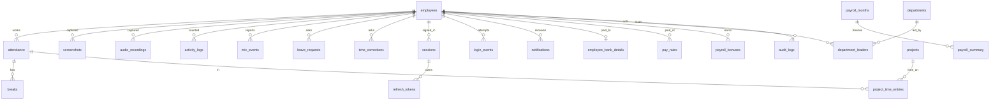

# Data model

32 tables (46 migrations). Instants are epoch milliseconds, dates are `YYYY-MM-DD` company time, money is integer cents, ids are UUIDs.

## People and access
| Table | Purpose |
|---|---|
| `employees` | Everyone: name, email, password hash, `role` (user/leader/admin), department, `status`, `is_account_admin`, consent flags and version, `must_change_password`, `blur_screenshots`, birthday, `totp_secret` (encrypted), `totp_enabled_at`, `totp_last_step`, `recovery_codes` (hashed) |
| `departments`, `department_leaders` | Departments and who leads them |
| `refresh_tokens` | Hashed refresh tokens: expiry, revoked at and reason, reuse count, `session_id` |
| `sessions` | One per sign-in: client, IP, user agent, device label and hash, two-step used, last seen, revoked at and reason |
| `login_events` | Every sign-in attempt: result (success, bad_password, bad_code, locked, deactivated), device, IP, new-device and two-step flags |
| `agent_connect_codes` | One-time hand-off codes for the desktop agent (hashed, 60 seconds) |
| `employee_bank_details` | Encrypted bank, branch, account number and name per employee |

## Attendance and capture
| Table | Purpose |
|---|---|
| `attendance` | A shift: punch in/out, date, break and worked seconds, idle seconds, `status` (open, on_break, closed), `over_break`, `auto_closed`, `needs_review` + reason, `source` (live, queued, correction), `corrected`. A partial unique index allows one open shift per person |
| `breaks` | Breaks of a shift, with `reason` (null, `signed_out`, `zoom_camera_off`) |
| `screenshots` | One row per image: file key, capture group, display index and label, captured at, `file_deleted` |
| `audio_recordings` | Samples: file key, length, `mic_muted`, consent verified, `file_deleted` |
| `activity_logs` | One row per active minute: key and mouse counts, window title (app), website domain |
| `mic_events` | Mic checks by the agent: muted, unavailable, live (with reason) |
| `projects`, `project_time_entries` | Optional project time tracking |
| `app_categories`, `app_department_categories`, `app_restrictions` | Productive / neutral / distracting per app, company-wide or per department |
| `time_corrections` | Requests to change a shift: original and requested times, reason, status, reviewer, note |

## Leave and calendar
| Table | Purpose |
|---|---|
| `leave_requests` | Type, day part, dates, reason, proof file key, status, reviewer, note |
| `company_holidays`, `holiday_years` | Holidays (auto-copied for repeating ones) and which years are filled in |

## Payroll
| Table | Purpose |
|---|---|
| `pay_rates` | Rate per employee with effective dates |
| `payroll_bonuses` | Bonuses per month |
| `payroll_summary` | Per employee per month: hours, days, pay, and the frozen `snapshot` once finalized |
| `payroll_months` | A row exists while a month is finalized (the freeze) |
| `payslip_emails` | Queue and result of payslip emails, per recipient |

## System
| Table | Purpose |
|---|---|
| `settings` | One row: capture, shift, retention, pay rules, leave allowances, two-step requirement, workday hours, company, payslip template |
| `notifications` | In-portal notifications with link and read time |
| `audit_logs` | Who did what to whom, when, from which IP, with details. Insert-only: no route edits or deletes it |
| `job_runs` | One row per scheduled job run, with what it affected |

## Migrations added in the latest work
`20261112` employee birthdays, `20261113` bank details, `20261114` account admin, `20261115` break reason, `20261116` Zoom camera break minutes, `20261117` workday hours, `20261118` time corrections, `20261119` leave allowances, `20261120` sessions, login events and two-step.

Run them in order on production before starting the new backend (see [Operations](06-OPERATIONS.md)).
